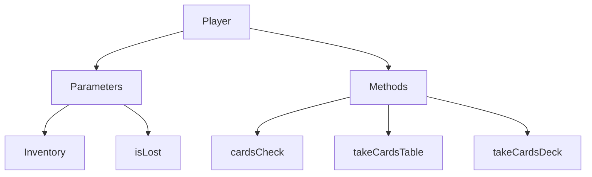

# Methods

- `cardsCheck` - проверяет сколько карт осталось у игрока
- `takeCardsTable` - забрать карты с игрового поля
- `takeCardDeck` - взять карту/ы с колоды

# Parameters

- `inventory` - класс Inventory
- `isLost` - bool значение проигрыша в раунде

